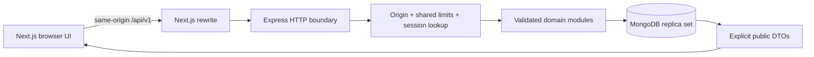

# Doctor Tracker API

Doctor Tracker is an administrator workspace for doctors, their assigned patients and operational trends. This standalone Express/TypeScript API provides validated REST endpoints, revocable opaque sessions, transactional patient counts and date-aware analytics over MongoDB. It is deployed separately from its Next.js client and uses fictional records only.

[Live frontend](https://doctor-tracker-shoyeb.vercel.app) · [Frontend repository](https://github.com/ShoyebWritesCode/Doctor-Tracker-Frontend) · [API health](https://doctor-tracker-api-shoyeb.vercel.app/health) · [API readiness](https://doctor-tracker-api-shoyeb.vercel.app/ready) · [OpenAPI JSON](https://doctor-tracker-api-shoyeb.vercel.app/api-docs/openapi.json)

## Reviewer access

There is one actor: an administrator. Use the following credentials to access the deployed fictional-data demo:

- Application: [Doctor Tracker](https://doctor-tracker-shoyeb.vercel.app)
- Email: `admin@example.test`
- Password: `CGG6NjlLjeucSEhQgw0VJxltfiyS1A_Q`

These credentials are intentionally public with the owner's approval. They grant full demo-administrator access, including editing and deleting demo records. Use fictional data only and never reuse this password for a real account or real-data environment. There is no public registration, email verification, or doctor/patient login. The disposable local credentials below are separate from this deployed demo login.

See the [frontend README](https://github.com/ShoyebWritesCode/Doctor-Tracker-Frontend#readme) for the product walkthrough and desktop/mobile screenshots.

## Local installation

Requirements: Node.js **22.17.1**, npm **10.9.2** and a transaction-capable MongoDB replica set. Both repositories commit their own lockfiles.

```bash
git clone https://github.com/ShoyebWritesCode/Doctor-Tracker-Backend.git
git clone https://github.com/ShoyebWritesCode/Doctor-Tracker-Frontend.git
cd Doctor-Tracker-Backend
npm ci
```

### Disposable review: no Atlas or `.env`

```bash
BROWSER_TEST_DEMO_DATA=1 npm run test:auth-server
```

This creates a temporary replica set, 24 fictional doctors, 256 patients and `browser-test@example.test` / `fictional-browser-verification-only`. It does not read `.env` or connect to an existing database. The first run downloads a MongoDB test binary and needs network access. Start the frontend on `http://localhost:3000` using its README. Fixture edits last only until this server stops. Never reuse these credentials in a persistent deployment.

### Persistent development

Use your own Atlas replica-set URI or configure a local replica set. A standalone MongoDB server cannot execute patient transactions. One development-only Docker alternative (Docker required, loopback-only exposure):

```bash
docker run --name doctor-tracker-mongo -d \
  -p 127.0.0.1:27017:27017 -v doctor-tracker-mongo-data:/data/db \
  mongo:7.0.24 --replSet rs0 --bind_ip_all
docker exec doctor-tracker-mongo mongosh --quiet --eval \
  'rs.initiate({_id:"rs0",members:[{_id:0,host:"localhost:27017"}]})'
```

Wait for `docker exec doctor-tracker-mongo mongosh --quiet --eval 'db.hello().isWritablePrimary'` to return `true`. The named volume persists local data across container restarts. This optional Docker recipe is not a claimed verification on a machine without Docker; the disposable fixture is the automated setup-verification path.

```bash
cp .env.example .env
```

Edit `.env`: supply the replica-set URI and replace `SEED_ADMIN_PASSWORD` with your own 12–128-character local password. Retain `FRONTEND_ORIGIN=http://localhost:3000` for the documented frontend. Then:

```bash
npm run seed:admin
npm run seed:demo
npm run seed:demo -- --apply
npm run dev
```

`seed:demo` without `--apply` is a dry run. The API defaults to `http://localhost:4000`; `/health` reports liveness and `/ready` checks MongoDB. Sign in through the frontend with the administrator you configured. Startup never creates accounts or seeds records. Re-running `seed:admin` explicitly resets that administrator's password/status; it does not revoke existing sessions.

## Environment

See [`.env.example`](.env.example). Configuration is validated before listening. Never commit `.env`, database credentials, private seed passwords or session cookies. The intentionally public fictional-demo login in Access is the owner-approved exception, not a pattern for real credentials.

| Variable                                                     | Local default/example          | Purpose                                                                                        |
| ------------------------------------------------------------ | ------------------------------ | ---------------------------------------------------------------------------------------------- |
| `NODE_ENV`                                                   | `development`                  | Production enforces HTTPS/Secure cookies and disables auto-indexing.                           |
| `HOST`, `PORT`                                               | `0.0.0.0`, `4000`              | Standalone listener; serverless hosting owns its listener.                                     |
| `MONGODB_URI`                                                | Replica-set URI in the example | Server-only database connection.                                                               |
| `FRONTEND_ORIGIN`                                            | `http://localhost:3000`        | Exact allowed browser origin, no wildcard/path.                                                |
| `SESSION_COOKIE_NAME`                                        | `doctor_tracker_session`       | Retain the default for the published client/contract.                                          |
| `SESSION_TTL_HOURS`                                          | `12`                           | Absolute lifetime; allowed range 1–24 hours.                                                   |
| `COOKIE_SECURE`                                              | `false` locally                | Must be `true` in production.                                                                  |
| `TRUST_PROXY_HOPS`                                           | `0` locally                    | Current Vercel ingress uses 1; reassess if topology changes.                                   |
| `LOGIN_IP_LIMIT`, `LOGIN_ACCOUNT_LIMIT`                      | `20`, `5`                      | Shared login budgets per 15-minute window.                                                     |
| `API_RATE_LIMIT`                                             | `600`                          | Shared API budget per IP per 60-second window.                                                 |
| `LOG_LEVEL`                                                  | `debug` in the example         | Use privacy-safe `info` logs in production.                                                    |
| `SEED_ADMIN_EMAIL`, `SEED_ADMIN_NAME`, `SEED_ADMIN_PASSWORD` | Fictional placeholders         | Explicit trusted bootstrap only; password minimum 12 characters. Not needed by normal runtime. |

The frontend alone uses `API_PROXY_TARGET` and `NEXT_PUBLIC_API_BASE_PATH`. Never expose backend secrets through `NEXT_PUBLIC_*`. Test-only `BROWSER_TEST_API_PORT`, `BROWSER_TEST_FRONTEND_ORIGIN` and `BROWSER_TEST_DEMO_DATA=1` configure the temporary fixture, not normal runtime.

## System architecture



Express is separate, not embedded in Next.js. Feature modules own schemas, routes, persistence and DTOs. Common middleware owns request IDs, safe errors, headers and limits. `createRuntimeApp` composes the same routing/security for the standalone process and Vercel adapter. Health/docs are read-only; domain routes require a live administrator session.

### Decision 1: opaque sessions rather than browser JWT storage

Argon2id verifies the password. A random opaque token is returned only in a host-only HttpOnly cookie; MongoDB stores its SHA-256 digest, administrator reference and absolute expiry. Every protected request checks expiry and active administrator status. TTL cleanup is asynchronous, not an authorization mechanism. Logout revokes the session before clearing its cookie.

The same-origin proxy keeps cookies first-party. Production requires Secure, SameSite=Lax, Path=/api/v1 and an exact allowed Origin for mutations. Tokens never enter browser storage. This adds a database lookup versus stateless JWT validation but makes revocation/account disabling straightforward. The administrator-only scope needs no third-party identity provider; MFA, recovery and extra roles need additional design.

### Decision 2: transactional counts and measured indexes

Doctor lists/ranking read denormalized `patientCount` instead of aggregating every patient's doctor on each request. Patient insert/delete and count increment/decrement commit in one MongoDB transaction, including concurrent-delete protection. The transaction/write cost buys coherent counts; rollback, race and reconciliation tests verify this tradeoff.

Indexes follow concrete query shapes: normalized unique emails, stable creation/name order, doctor/condition/status filters and bounded ranking/count scans. Search is escaped literal prefix matching, not executable regex input. Explain-plan reports retain examined-key/document and residual-sort evidence rather than claiming every filter is index-only. Offset pagination suits this bounded demo; deep collections need measured cursor/search changes. See query reports below.

## API and implementation guide

- Canonical [OpenAPI 3.1 source](docs/openapi.yaml), served read-only at `/api-docs/openapi.json`, without an interactive explorer. Contract tests compare health/readiness, administrator, doctor/patient/list, analytics and error responses against documented JSON Schemas.
- [Architecture decisions](docs/architecture-decisions.md): envelopes, fields, session policy and scope.
- [Doctor queries](docs/doctor-query-plans.md): create/detail, search/filter/sort and pagination.
- [Patient API](docs/patient-api.md): scoped create/list/delete, global list/detail/patch/delete, immutable doctor assignment, date/null semantics and transactions.
- [Dashboard](docs/dashboard-analytics.md): all-time totals/ranking, local-calendar ranges, zero-filled daily series and consistency limits.
- [Security/operations](docs/security-and-operations.md): exact Origin/CORS, shared atomic limits, privacy-safe logs and lifecycle.
- [Testing/performance](docs/testing-and-performance.md): coverage gates, races, query plans, bounded load and limitations.
- [Submission checklist](docs/submission-checklist.md): requirement mapping and reviewer handoff.

## Commands and verification

| Command                                              | Purpose                                                        |
| ---------------------------------------------------- | -------------------------------------------------------------- |
| `npm run dev`                                        | Standalone server in watch mode.                               |
| `npm run build` / `npm start`                        | Compile to `dist/` / run compiled Node server.                 |
| `npm run seed:admin`                                 | Explicitly create/update the configured administrator.         |
| `npm run seed:demo` / `npm run seed:demo -- --apply` | Preview / insert missing fictional records.                    |
| `npm run lint` / `npm run typecheck`                 | Zero-warning lint / strict type-check.                         |
| `npm test` / `npm run test:run`                      | Watch / one-shot tests.                                        |
| `npm run test:coverage`                              | All-source coverage with enforced gates.                       |
| `npm run test:runtime`                               | Verify compiled native-Node imports.                           |
| `npm run test:auth-server`                           | Real routes with disposable MongoDB and fictional credentials. |
| `npm run test:load`                                  | Isolated bounded load smoke; never target production.          |
| `npm run docs:check`                                 | Verify local documentation links.                              |
| `npm run format` / `npm run format:check`            | Apply / check formatting.                                      |

```bash
npm ci
npm run format:check
npm run lint
npm run typecheck
npm run test:coverage
npm run build
npm run test:runtime
```

Tests create temporary databases, not Atlas connections. Frontend CI runs optimized desktop/mobile jobs against a reviewed, pinned backend revision. Standard integration fixtures start empty; only explicit documentation/review mode seeds the richer dataset.

## Existing deployment and operations

Both apps already run on Vercel. This documents the existing topology, not a request to reprovision infrastructure or tag another release. Root `index.ts` exports Express; `src/server.ts` retains the standalone listener/graceful shutdown. MongoDB connections are lazy, shared per warm function instance and capped at five per pool. `/health` is database-independent; `/ready` checks MongoDB. Standalone shutdown tests do not establish serverless lifecycle guarantees.

Backend production variables: `NODE_ENV=production`, server-only `MONGODB_URI`, `FRONTEND_ORIGIN=https://doctor-tracker-shoyeb.vercel.app`, `COOKIE_SECURE=true`, `TRUST_PROXY_HOPS=1`, and privacy-safe logging. The frontend proxies `/api/v1` to `https://doctor-tracker-api-shoyeb.vercel.app`. Production secrets are not shared with preview builds. `vercel.json` selects Express/Mumbai near Atlas; package engines select Node 22 even if the dashboard default differs.

Production disables automatic indexes. Before using a new environment, create schema-declared indexes from trusted operator tooling using each model's `createIndexes()`, never destructive `syncIndexes()`. Seed the administrator explicitly, not at startup, and do not upload seed passwords to hosting. Shared login/API counters need their TTL indexes and fail closed if unavailable. Verify health/readiness and browser workflows after hosting changes.

The demo seeder uses stable IDs and one transaction, adds missing records without replacing administrator edits, does not inflate counts on re-run, and restores deleted demo records if explicitly rerun. It never resets the database or runs on deployment. Names/records are invented, emails use `.example.test`, and placeholder phone numbers are not real contacts.

## Boundaries and production-readiness limits

This is not a certified health-data system. Do not enter real personal/clinical data. Permanent deletion has no recovery UI/audit history. Doctor update/delete, reassignment, extra roles, registration, email verification, recovery, billing and appointments are outside version 1. Analytics are current-record reads, not immutable history or one cross-query snapshot.

Free/demo hosting is not a promise of network isolation, automated backups, restore drills, high availability or service-level objectives. Vercel Hobby can have dynamic outbound IPs; broader Atlas allowlisting is an operator tradeoff, not a production security guarantee. Before real-data use, review access/network restrictions, backups/restores, MFA/roles, audit/retention, monitoring, pool/concurrency budgets and representative load. Never enable paid networking automatically. Local load/Lighthouse measurements do not establish production throughput or field percentiles.
